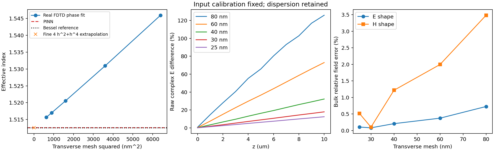
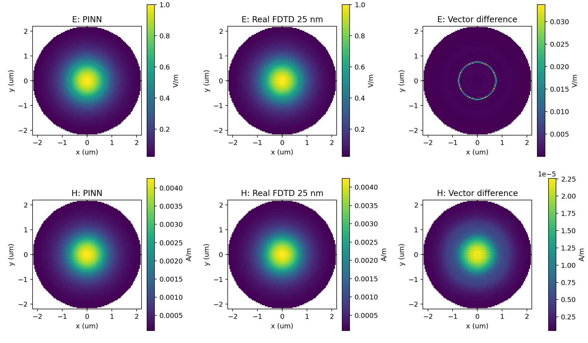

# 圆偏振分层光纤 PINN：真实三维 FDTD 验证

日期：2026-10-13。分支：`codex/fdtd-fiber-validation`，从 `codex/cylindrical-circular-layers` 的 `7095580` 创建独立 worktree。使用已训练的 `results/fiber_circular/model.pt`，验证期间未重新训练或用 FDTD 标签调整网络。

## 结论

已使用本机有许可证的 **Ansys Lumerical 2024 R1 三维时域求解器**完成五档网格仿真，并重新打开各个保存的 FSP 工程检查完成状态、实际波长、网格与 PML 距离。这里的 FDTD 数据来自实际时域运行；源的数值 FDE 模态只用于注入，不作为传播结果。

最细 25 nm 横向网格下，输入横截面完整区域的 PINN/FDTD 复矢量相对 L2 差异为 **E 0.80675%、H 0.51464%**。两条介质界面分别取内外侧极限，E 差异为 **0.22881%–0.33680%**，H 为 **0.57120%–0.72913%**。场形吻合较好，但这些值包含 FDTD 离散、插值及界面取样误差，不能全部归因于网络。

传播 10 μm 后，保留相位的完整复场差异仍为 **E 12.47181%、H 12.46401%**。网格加密使该差异显著下降；相位独立对齐后的场形差异为 E 0.80686%、H 0.51285%。不能用场形指标宣称原始输出复场已经达到 1% 精度。

有效折射率的细网格外推估计为 1.5125687863，PINN 比它高 2.3902×10⁻⁵（约 **+0.00158%**）；拟合方式敏感度为 3.7661×10⁻⁵（约 **0.00249%**），大于估计偏差。当前证据支持小幅偏差，但还不足以精确确定这个量级的真实网络偏差。

## 1. 相同的物理问题

| 参数 | 设置 |
| --- | --- |
| 真空波长 | 1.55 μm；实际监视器频率已核对 |
| 内芯 | r < 0.75 μm，n=1.60 |
| 环形介质层 | 0.75 < r < 1.50 μm，n=1.45 |
| 外包层 | r > 1.50 μm，n=1.44 |
| 材料 | 实折射率、无损、非磁、各向同性 |
| 传播与激励 | 沿 +z 的基阶混合导模；轴心 Ey=iEx 的圆偏振 |
| 测量区域 | r≤4 μm，z=0,1,…,10 μm；保留 Ex/Ey/Ez、Hx/Hy/Hz |
| 振幅 | 输入轴心复 E 矢量模长 1 V/m；H 单位 A/m |

这里的两层分界面是沿 z 延伸的同轴圆柱面。验证对象是直光纤稳态导模传播，不包括沿 z 突变的材料层、端面耦合、弯曲或损耗。复场约定为 exp(−iωt)，传播因子为 exp(+iβz)。圆偏振需要正交分量的相对相位；界面附近允许局部椭圆偏振及非零纵向场。[Ansys 圆偏振与相位约定](https://optics.ansys.com/hc/en-us/articles/1500006150981-Circular-polarization-and-phase-convention)

## 2. 独立 FDTD 设置与审计

实际求解器版本为 8.31.3633；1 个进程、8 个线程。求解域为 14×14×16 μm，z∈[−3,13] μm，六面为 12 层 PML；介质圆柱延伸穿过轴向 PML。源位于 z=−1 μm、横向窗口 10×10 μm；输出监视器位于 z=10 μm。最粗网格下，源到下侧 PML 内边界仍有 0.567 μm、输出到上侧 PML 内边界有 1.567 μm，源窗口到侧 PML 有 0.566 μm；各档均已检查为正。

芯区及环层附近的 4.2×4.2 μm 方形区域采用 h=80/60/40/30/25 nm 的横向网格限制；纵向网格限制为 1.5h，外侧横向网格限制固定 120 nm。监视器导出的实际网格非均匀，计算积分时按实际坐标赋予面积权重，未假设等间距。单频监视器统一在 1.55 μm 采样。时间上限 600 fs，auto shutoff 为 10⁻⁷，所有工程的求解状态均为 **2：达到自动停止阈值**。[Ansys FDTD 状态说明](https://optics.ansys.com/hc/en-us/articles/360034382534-FDTD-solver-Simulation-Object)

源由独立 FDE 求得的数值模态构造圆偏振，并将数值 E 与 H 一起冻结为 imported source。未导入 PINN 或 Bessel 参考场，也未使用 PINN 的 β。最终实现对单个模态构造旋转/互易对称伙伴，以避免简并模态搜索重复返回同一矢量；所有接受的算例均检查源混合矩阵条件数与传播轴心圆偏振度。[Ansys mode source](https://optics.ansys.com/hc/en-us/articles/360034902153-Mode-source-Simulation-object)、[import source](https://optics.ansys.com/hc/en-us/articles/360034383014-Import-source-Simulation-object)

| h / nm | 实际三维网格节点数 | 时域传播拟合 n_eff | 输入 E 差异 / % | 输入 H 差异 / % | 输出原始复 E 差异 / % | 功率沿程变化 / % |
| --- | --- | --- | --- | --- | --- | --- |
| 80 | 138×138×135 | 1.5459408246 | 1.57691 | 3.45398 | 125.82089 | 3.42528 |
| 60 | 155×155×179 | 1.5309379143 | 1.22661 | 1.99322 | 72.92446 | 1.92245 |
| 40 | 192×192×268 | 1.5205661891 | 1.01408 | 1.20945 | 32.25370 | 0.84621 |
| 30 | 229×229×357 | 1.5170355084 | 0.88240 | 0.12446 | 17.93861 | 0.47672 |
| 25 | 257×257×428 | 1.5156607072 | 0.80675 | 0.51464 | 12.47181 | 0.33027 |

五档实际时域引擎运行约 13.1、25.1、82.4、191.2、323.1 秒；包含运行接口开销后约 18.0、31.5、90.4、204.9、342.4 秒。保存工程的状态、实际波长、运行时间、线程数与 SHA256 见 [solver_audit.json](../results/fdtd_validation/solver_audit.json)，脱敏求解器证据见同目录的 `solver_evidence_*nm.txt`。

H 的误差未单调下降，30 nm 的数值小于 25 nm，因此不能只挑选 30 nm 结果宣称更高精度。Yee 网格的 E/H 空间交错、介质界面与网格的相对位置、监视器插值会影响这类比较；本验证统一设置为 `specified position`。[Ansys 频域监视器与空间插值](https://optics.ansys.com/hc/en-us/articles/360034902393-Frequency-domain-monitor-Simulation-object)



## 3. 指标、偏差与相位处理

用输入 z=0 轴心圆偏振分量求得一个复数标定系数，统一乘到全部 FDTD E/H 与所有 z 平面；不逐平面拟合幅值。该系数消除源的功率归一化差异，同时确定输入相位；因此此验证针对固定输入归一化后的相对场，未验证绝对入射功率耦合效率。

矢量相对误差：δ_F = sqrt(∫|F_PINN−F_FDTD|²dA / ∫|F_FDTD|²dA)。完整区域为 r≤4 μm，包含两个界面。另列 bulk 区域：从完整区域中剔除每个界面半径两侧各 0.16 μm 的带状区域，五档网格使用相同物理宽度。界面数据单独比较，不能以 bulk 数值代替全截面精度。

场形指标仅消除该平面 FDTD 轴心相位，并与 PINN 的 z=0 场比较；幅值不变。原始复场指标直接比较同一 z 的场，保留传播相位差。各指标记录在 [comparison.json](../results/fdtd_validation/comparison.json) 和 [plane_metrics.csv](../results/fdtd_validation/plane_metrics.csv)。

| 25 nm 结果 | E | H |
| --- | --- | --- |
| z=0，完整区域复场差异 | 0.80675% | 0.51464% |
| z=0，bulk 复场差异 | 0.10618% | 0.51772% |
| z=10 μm，完整区域原始复场差异 | 12.47181% | 12.46401% |
| z=10 μm，完整区域相位对齐后场形差异 | 0.80686% | 0.51285% |
| z=0，bulk 场模长的有符号面积均值偏差 | +2.29513×10⁻⁵ V/m | +9.10725×10⁻⁷ A/m |
| z=0，bulk 复矢量 RMSE | 1.52274×10⁻⁴ V/m | 3.08487×10⁻⁶ A/m |

有符号偏差定义为 ⟨|F_PINN|−|F_FDTD|⟩_A，正值表示 PINN 平均模长更大。RMSE 为 sqrt(⟨|F_PINN−F_FDTD|²⟩_A)，包含三分量；以上均采用固定的输入标定。数值针对轴心 1 V/m 的线性归一化，其物理单位下的值会随输入振幅同比缩放。



上图在统一绘图坐标上展示 z=0；差值是复矢量差的模长。积分指标采用原始监视器网格，图中显示范围为 r≤2.2 μm，指标范围仍为 r≤4 μm。

## 4. 两个介质分界面的 E/H

法向 E 可跳变，不能把界面两侧平均成一个 E 值。每条圆柱界面取 129 个周向位置，分别从同侧距离界面 2h/3h/4h 的点作二次外推；没有跨介质插值取极限。将取样改为 3h/4h/5h，用于估计外推敏感度。下表为 **25 nm、z=0** 的三分量复矢量周向相对 L2 差异。

| 界面及介质侧 | E 差异 | H 差异 | E 取样敏感度 | H 取样敏感度 |
| --- | --- | --- | --- | --- |
| r=0.75 μm，芯层侧 n=1.60 | 0.26646% | 0.61294% | 0.26082% | 0.25514% |
| r=0.75 μm，环层侧 n=1.45 | 0.25018% | 0.57120% | 0.22992% | 0.17470% |
| r=1.50 μm，环层侧 n=1.45 | 0.22881% | 0.59819% | 0.15341% | 0.15109% |
| r=1.50 μm，外包层侧 n=1.44 | 0.33680% | 0.72913% | 0.11080% | 0.10929% |

对第一界面，FDTD 平均 |E_r,out/E_r,in|=1.218020，介质法向 D 连续所要求的 n_in²/n_out²=1.217598；第二界面分别为 1.012550 与 1.013937。FDTD 外推迹的切向 E/H 相对不连续度分别为第一界面 0.25485%/0.14891%，第二界面 0.13754%/0.14145%。这些残差给出界面数值取样误差的尺度。

完整 CSV：[interface_1_comparison.csv](../results/fdtd_validation/interface_1_comparison.csv)、[interface_2_comparison.csv](../results/fdtd_validation/interface_2_comparison.csv)。各自包含 `phi_rad` 与内外侧的 Ex/Ey/Ez/Hx/Hy/Hz 实部、虚部，PINN 与 FDTD 一一配对。当前侧迹指标只在 z=0 单独评估；沿程横截面已评估 z=0…10 μm，不能把输入界面的数值误差直接认定为整张圆柱表面的原始复场误差。

## 5. 有效折射率及可分辨的精度

FDTD β 从轴心圆偏振分量 (Ex−iEy)/√2 的展开相位对 z 线性拟合获得，范围 0.25≤z≤9.75 μm；n_eff=β/k₀。拟合时未输入网络 n_eff。所有接受的算例在拟合区间轴心圆偏振度 >0.9999999999。[axis_phase_traces.npz](../results/fdtd_validation/axis_phase_traces.npz) 保留五档未标定的轴心复 E 数据，可独立重复相位拟合。

| 方法 | n_eff |
| --- | --- |
| PINN | 1.5125926885 |
| 独立 Bessel 模态匹配参考 | 1.5125510200 |
| 25 nm 原始 FDTD 相位拟合 | 1.5156607072 |
| 60/40/30/25 nm 按 h²+h⁴ 外推（主估计） | 1.5125687863 |
| 全五档按 h²+h⁴ 外推 | 1.5125311257 |
| 40/30/25 nm 按 h²+h⁴ 外推 | 1.5125618625 |
| 40/30/25 nm 仅按 h² 外推（诊断） | 1.5125106672 |

主估计与其他二次拟合的最大差值 3.7661×10⁻⁵ 是**拟合敏感度，不是统计置信区间或严格总误差界**。外包层横向网格固定 120 nm，PML 厚度、域尺寸与停止阈值也未另做独立扫描，所以这里外推的是芯区/纵向网格加密路径，并非所有数值参数同时趋于连续极限。

25 nm 的原始 FDTD 与 PINN 相位常数在 10 μm 上相差约 0.1244 rad（7.13°），足以产生约 12.4% 的复场差异。五档结果及外推与独立 Bessel 参考吻合，支持 FDTD 数值色散是这个差异的主要来源，但不把外推拟合当作严格证明。

完整复场逐点外推也保留为诊断：bulk 区域 PINN/FDTD 外推场的 E/H 差异约 0.15549%/0.39885%，更换外推方式带来的场差异约 0.43970%/2.69277%。特别是 H 外推尚不稳定，**不将这两个外推场数值作为已证明的网络精度**。独立 Bessel 检查仍是同一理想导模问题的补充验证，不能替代 FDTD 或验证任意器件。

## 6. 复现与文件

需要 Python≥3.10、项目依赖以及可用许可证的 Lumerical FDTD。`LUMAPI_PATH` 可指向本机 `api/python/lumapi.py`，默认使用此次实际安装路径。工作目录为仓库根目录。

```powershell
python -m pip install -e .
$env:LUMAPI_PATH = 'D:\Program Files\Lumerical\v241\api\python\lumapi.py'
foreach ($mesh in @(80, 60, 40, 30, 25)) {
    python -m fdtd_validation.probe --mesh-nm $mesh --run
    if ($LASTEXITCODE -ne 0) { throw "FDTD run failed: $mesh nm" }
}
python -m fdtd_validation.audit
python -m fdtd_validation.analysis
python -m unittest discover -s tests -v
```

研究设置记录于 [fdtd_fiber_study.json](../configs/fdtd_fiber_study.json)；命令中的默认物理设置与其一致，这个 JSON 当前是研究记录，非通用配置加载入口。只构建/预计算源并保存工程可省略 `--run`。重新运行会覆盖对应网格的本地输出。

实际 FSP、全部 11 个横截面复场、独立源与网格保存在本机 `runs/fdtd/{80,60,40,30,25}nm/`。这些大型工程和原始引擎日志不提交；仓库包含可重跑的代码、网格与完成审计、文件哈希、轴心数据、完整指标、界面 CSV 和场图。网络 checkpoint 的 SHA256 为 `0de99aaa21f4179a58a5bfc530b472b41e4fae1fefd0ee3683e748222297d6e9`。

17 项物理及分析测试通过，新增测试覆盖非均匀面积积分、矢量旋转、同侧界面外推、网格外推和供应商数据坐标排列。普通测试及 GitHub CI 不需要商业求解器；它们不能代替本机已完成的真实 FDTD 运行。
