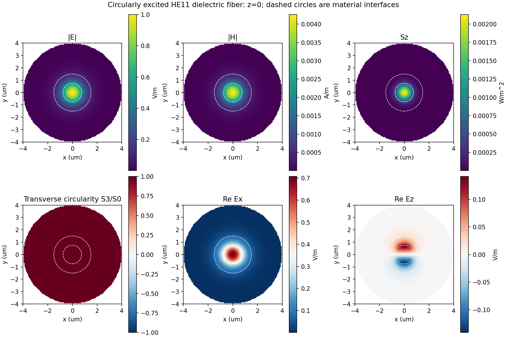
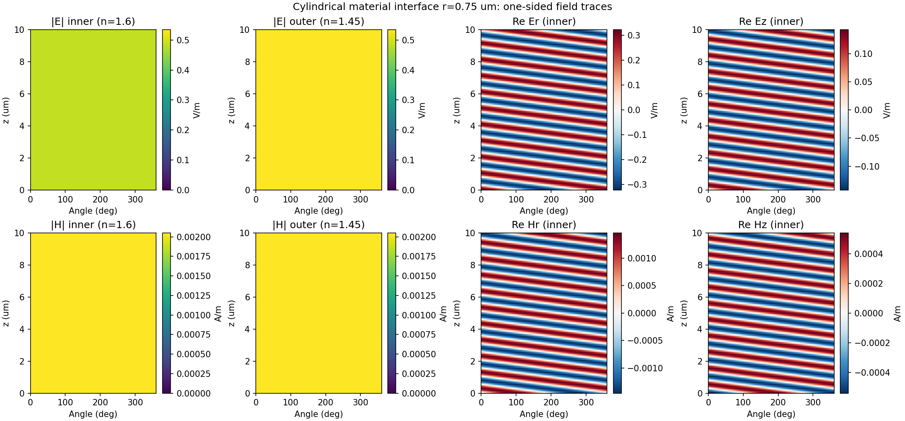
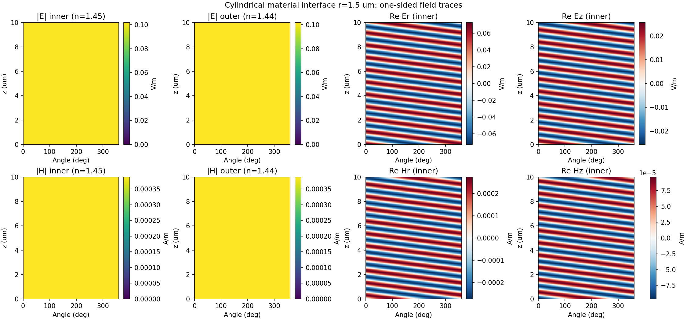

# 三层圆柱介质光纤：界面 E/H 实测报告

测试日期：2026-10-12。独立 worktree / 分支 `codex/cylindrical-circular-layers`。

默认几何：λ=1.55 μm，计算半径 4 μm，高度 10 μm；三层径向同轴介质 n=1.60 / 1.45 / 1.44，两个圆柱分界面半径为 0.75 与 1.50 μm。外部为无限包层的衰减边界；材料沿 z 不变。

轴心复 E 模长为 1 V/m，两个正交激励分量等幅且相差 π/2。Ez 和 Hz 保留，局部偏振见 Stokes 图。

## 参考验证

| 指标 | 实测 |
| --- | --- |
| PINN neff | 1.5125926885 |
| 独立 Bessel 界面匹配 neff | 1.5125510200 |
| neff 相对误差 | 0.002755% |
| 横截面 E 相对 L2 误差 | 0.100924% |
| 横截面 H 相对 L2 误差 | 0.086112% |
| 传播 10 μm 后复 E 误差 | 0.196783% |
| 传播 10 μm 后复 H 误差 | 0.189609% |
| 独立 513 点/层 PDE 损失 | 7.392e-08 |
| 轴心 Stokes S3/S0 | 1.000000 |
| 计算圆柱内传输功率 | 2.713884e-15 W |

## 分界面场强

以下是复场范数 |E| 与 |H|，不是某时刻实场模长。圆偏振组合与圆柱对称性使该范数在每个界面上不随角度、z 改变；六个场分量的复相位随角度及 z 变化，CSV 与 NPZ 保留这些变化。

| 界面 | r (μm) | E 模长内侧 (V/m) | E 模长外侧 (V/m) | H 模长内侧 (A/m) | H 模长外侧 (A/m) | Er 幅值外/内 |
| --- | --- | --- | --- | --- | --- | --- |
| 1 | 0.75 | 0.484756 | 0.534084 | 0.00204871 | 0.00204870 | 1.217603 |
| 2 | 1.50 | 0.101032 | 0.101759 | 0.00038804 | 0.00038803 | 1.013932 |

法向电场允许跳变，εEr 连续。第一界面理论外/内比为 1.217598，第二界面为 1.013937；切向 E/H 和法向 D/B 均须连续。H 在 μr=1 的两侧应连续。以下跳变量是神经结果的数值误差，不是把界面两侧场先平均再计算。

| 界面 | 切向 E 相对跳变 | 切向 H 相对跳变 | 法向 D 相对跳变 | 法向 B 相对跳变 |
| --- | --- | --- | --- | --- |
| 1 | 1.096e-05 | 8.163e-06 | 4.265e-06 | 1.026e-05 |
| 2 | 2.310e-05 | 5.118e-06 | 5.252e-06 | 2.380e-05 |

## 可查看的结果

### 界面 1：r=0.75 μm

[内外侧复 E/H CSV](../results/fiber_circular/interface_1.csv)

### 界面 2：r=1.5 μm

[内外侧复 E/H CSV](../results/fiber_circular/interface_2.csv)

[全部指标](../results/fiber_circular/metrics.json) · [训练历史](../results/fiber_circular/history.json) · [已训练权重](../results/fiber_circular/model.pt)

完整界面 NPZ 位于本地 `runs/fiber_circular/interface_1.npz`、`interface_2.npz`，数组为 `[z, phi, component]`，含 Cartesian 和柱坐标六分量、内外两侧迹。CSV 提供 z=0 和 z=L 上的全部 129 个角度。跨整个截面的输入/输出复场在 `cross_section.npz`；圆柱外点为 NaN，`inside` 标记有效域。

## 验证与范围

验收阈值保持固定：neff 误差 <0.01%；E/H 与输出复场误差 <2%；界面复场参考误差 <2%；PDE 损失 <10^-5；界面/外边界损失 <10^-7；界面条件相对跳变 <0.2%；独立 Cartesian Maxwell 残差 <1%。完整数值见 metrics。

物理单元测试包含正交模式的 π/2 叠加、两种旋向、轴心正则性、六分量传播相位、法向电场跳变、Maxwell 旋度/散度及可微开放边界与 SciPy 对照。保存权重重载后还核对横截面与每个分界面的全部复场。

训练未使用参考场标签。当前是同轴、沿 z 不变、无损介质的 HE11 导模模型；利用对称性将全矢量方程约化到径向网络。端面为前向导模输入/输出，不模拟自由空间入射或端面反射。材料分界面是圆柱面，尚不包含沿 z 的材料接缝和相应散射。

运行方法、完整物理方程与边界条件见 [模型说明](cylindrical_fiber_zh.md)。
