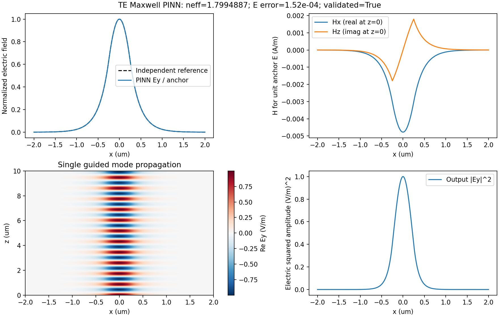
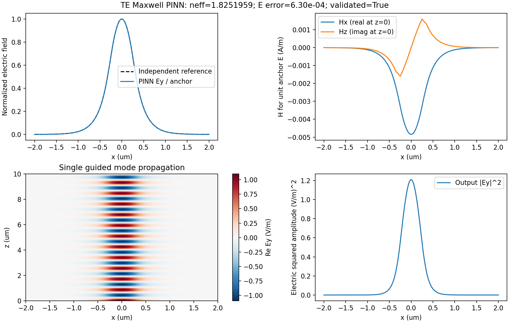
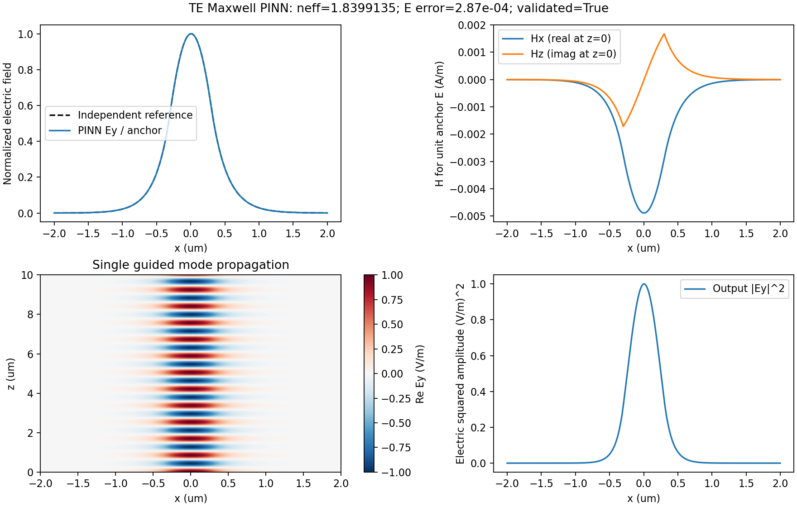

# 原型实测验证

测试日期：2026-10-11。CPU 单线程、float64；Python 3.10.21、PyTorch 2.3.1、NumPy 1.21.5、SciPy 1.7.3。每个配置独立训练，随机种子 7，宽度 32，Adam 1500 步 + L-BFGS 最多 400 迭代。L-BFGS 线搜索可以多次调用损失，因此历史中的调用次数可大于 400。

λ=1.55 μm，传播长度 10 μm。E/H 误差均为相对 L2，场形误差包含整个导出横向范围；输出误差比较 z=L 的复场，包含累计相位误差。E/H 场标签未参与训练。

| 配置 | PINN neff | 独立参考 neff | E 场形误差 | H 场形误差 | 输出复 E 误差 | 输出复 H 误差 | 独立点 PDE 损失 |
| --- | --- | --- | --- | --- | --- | --- | --- |
| slab | 1.7994886751 | 1.7994876339 | 0.01519% | 0.01503% | 0.01576% | 0.01561% | 9.811e-07 |
| coated_slab | 1.8251959350 | 1.8251827248 | 0.06298% | 0.06115% | 0.06589% | 0.06514% | 4.220e-06 |
| asymmetric_slab | 1.8399135297 | 1.8399166067 | 0.02865% | 0.02833% | 0.03125% | 0.03096% | 2.516e-06 |

## slab

[完整指标](../results/slab/metrics.json) · [训练历史](../results/slab/history.json) · [输出截面 CSV](../results/slab/output_cross_section.csv) · [已训练权重](../results/slab/model.pt)

## coated_slab

[完整指标](../results/coated_slab/metrics.json) · [训练历史](../results/coated_slab/history.json) · [输出截面 CSV](../results/coated_slab/output_cross_section.csv) · [已训练权重](../results/coated_slab/model.pt)

## asymmetric_slab

[完整指标](../results/asymmetric_slab/metrics.json) · [训练历史](../results/asymmetric_slab/history.json) · [输出截面 CSV](../results/asymmetric_slab/output_cross_section.csv) · [已训练权重](../results/asymmetric_slab/model.pt)

## 适用范围与解释

三层对称波导参考为解析色散方程和独立传输矩阵；两者的本征值与场一致至浮点精度。包覆与非对称波导参考为独立传输矩阵。所有案例使用精确的无限包层衰减边界。

功率在单模传播中保持恒定；这是传播公式保证的结果，不能单独证明神经求解精度。五层包覆示例只传播高斯轮廓的基模投影，L2 保留比例不是严格端口耦合效率。

测试还验证了 Maxwell 旋度符号、解析模式残差、H 单位、相位、界面连续性、非法配置处理。未训练网络的示例被验收门拒绝，CLI 返回退出码 2。保存权重重新加载后与原有场数组一致。

这些结果展示三个配置的正确性，不证明任意几何泛化。原型仍是一维截面 TE 基模，尚未覆盖纵向结构变化、TM、高阶模式或二维全矢量器件。

完整传播数组 `fields.npz` 位于本地 `runs/<配置>/`，避免把大数组放进 Git；可通过 README 命令重新生成。仓库保留小型训练权重、输出截面、图片、指标与历史。
